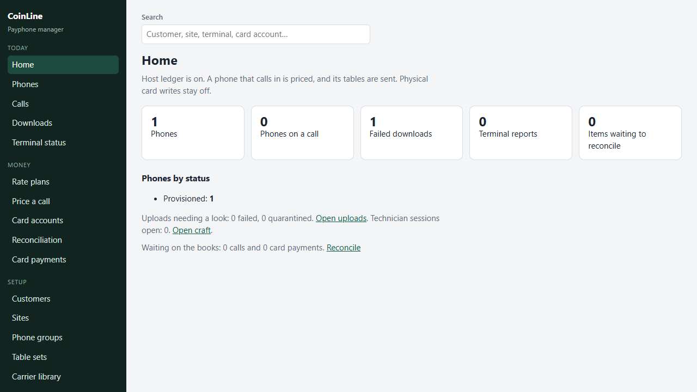
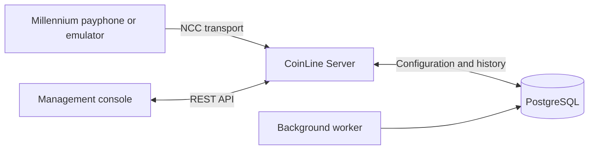

# CoinLine

**Manage Millennium payphones from a modern, self-hosted web console.**

[](https://github.com/andrew867/CoinLine/actions/workflows/backend.yml)
[](https://github.com/andrew867/CoinLine/actions/workflows/web.yml)
[](https://github.com/andrew867/CoinLine/actions/workflows/docs.yml)
[](LICENSE)

CoinLine is an open-source server for maintaining and provisioning Nortel Millennium payphones. It provides the tools a fleet operator needs to configure phones, deliver their tables, manage rates, inspect alarms, and investigate failed downloads without keeping a legacy Windows workstation alive.

The project consists of an NCC host, a PostgreSQL database, a REST API and a browser-based management console. It can work with a terminal emulator over TCP, or with appropriately configured telephone and modem equipment. It runs on infrastructure you control.

[Quick start](#get-started) | [Operator guide](docs-site/docs/operator-guide/overview.md) | [Documentation](docs-site/docs/index.md) | [Compatibility and evidence](docs/program/table-catalog-and-parity-audit.md)



*CoinLine in a local demonstration with fictional data.*

## What you can do

| Area | In the console |
| --- | --- |
| **Fleet management** | Register phones and their firmware, organize customers, sites and groups, review assignments and status. |
| **Terminal configuration** | Create, edit, compare and publish versioned configuration sets. Review the firmware record lengths and dependencies before assigning a set. |
| **Advertising** | Author text messages and graphical screens, preview bitmap artwork and rotation, and configure supported softkey links. |
| **Downloads** | Queue full or selected table deliveries, schedule fleet rollouts, and follow individual acknowledgement and failure states. |
| **Calling and rating** | Configure screening, speed dial, quick-access keys, terminal tariffs, host rating plans and carrier policy. Review quotes and uploaded call records separately. |
| **Field operations** | Read terminal alarms and maintenance events, inspect NCC sessions, cashbox reports, decoded uploads and audit history. |
| **Accounts and firmware** | Manage operators, card account administration and firmware packages. Runtime payment approvals and live firmware programming have separate integration and validation requirements. |

## How it works

A phone contacts the NCC listener. CoinLine identifies it, responds to the supported dialogue, and records what happened. When the phone requests configuration, it receives the applicable records from its assigned or queued set. A successful download requires acknowledgement from the phone, not simply a successful server send.



The console and API are separate from the phone's firmware and from any telephone service provider. An emulator or compatible gateway is required to exercise terminal behavior; CoinLine does not ship firmware or telephone service credentials.

## Get started

The shortest route to a local installation is Docker Compose. Install [Docker](https://docs.docker.com/get-docker/) with Compose support, clone this repository, and run:

```bash
git clone https://github.com/andrew867/CoinLine.git
cd CoinLine/docker
docker compose up -d --build
```

Open the console at **http://localhost:8080**. The evaluation stack creates a local operator account, as documented in the [Docker lab guide](docker/README.md). Database and table payload files remain in `docker/data/` across normal container restarts.

| Local service | Address |
| --- | --- |
| Management console | http://localhost:8080 |
| API and Swagger | http://localhost:5006/swagger |
| API health | http://localhost:8080/health |
| Readiness | http://localhost:8080/ready |
| NCC listener | `localhost:4000` (TCP) |

To connect an emulator, start it independently and direct its NCC connection to TCP port 4000. Register the phone using its actual five-byte wire identity, select its firmware, and assign a compatible published set. Start with the [emulator acceptance guide](docs/program/phase-5-emulator-acceptance.md) and [table management guide](docs-site/docs/operator-guide/table-management.md).

The default Compose stack is for local evaluation. For a real deployment, use the [production overlay](docker/README.md#production-overlay), configure authentication, disable demo seeding, protect the NCC and telephone-facing ports, and configure TLS, database backups and service integrations. See [Server deployment](docs-site/docs/deployment/server-deployment.md) and [Security](docs-site/docs/security/security-overview.md).

## From a new phone to a working configuration

1. Register the terminal, including its firmware profile and terminal type.
2. Create a draft table set, or clone a known-good set for that firmware.
3. Edit the phone's settings in the native table editors. Review the profile checks and any unconfigured optional families.
4. Publish the draft and assign it to the phone or fleet. Queue the exact records that need to change.
5. Let the phone call the host or use the appropriate supported maintenance workflow. Inspect the resulting download, acknowledgements and field events.
6. Verify the intended behavior on the terminal. A table acknowledgement alone does not show that a rate, payment rule, advertisement or service behaves correctly.

## Compatibility and project status

CoinLine implements many of the configuration and operational workflows familiar to Millennium fleet operators. Compatibility is tracked per firmware and terminal family, not as one blanket certification.

The project has exercised real NCC dialogues with emulated controller firmware, including older Multi-pay, later standard Multi-pay and MTR 2.12-based type 40 graphical Multi-pay. Observations include acknowledged installation records, clock and maintenance exchanges, a live rating request and on-screen charge, terminal-rendered text advertising, and all sixteen distinct bitmaps in the initial graphical rotation. These are emulator results, not physical terminal certification.

The [table catalogue and parity audit](docs/program/table-catalog-and-parity-audit.md) separates native editor coverage, encoding and byte preservation, receipt acknowledgements, and actual terminal behavior. It also identifies the remaining stock hardware, optional service, payment, code-download and reporting tests. The [known limitations](docs-site/docs/reference/known-limitations.md) describe the broader deployment boundaries.

## Develop and test

| Component | Stack |
| --- | --- |
| Server and NCC host | .NET 9, ASP.NET Core |
| Storage | PostgreSQL 16 and EF Core |
| Management console | React, TypeScript, Vite |
| Automated checks | xUnit, Vitest, Playwright |
| Documentation | MkDocs Material |

Install the [.NET 9 SDK](https://dotnet.microsoft.com/download/dotnet/9.0), [Node.js 20 or newer](https://nodejs.org/) and a local PostgreSQL server, or use the Compose database. The [developer quickstart](docs-site/docs/getting-started/quickstart.md) documents the required setup and database migrations.

```bash
cd backend
dotnet tool restore
dotnet build
dotnet test
```

```bash
cd web
npm ci
npm run build
npm run test
npx playwright install --with-deps chromium
npm run e2e -- e2e/failed-download.spec.ts
```

The browser workflow uses local deterministic fixtures; no emulator, licensed firmware, payment processor or external telephone call is required in CI.

## Documentation

| I want to... | Start here |
| --- | --- |
| Install or operate CoinLine | [Quickstart](docs-site/docs/getting-started/quickstart.md), [Docker lab](docker/README.md), [Server deployment](docs-site/docs/deployment/server-deployment.md) |
| Manage phones and settings | [Operator guide](docs-site/docs/operator-guide/overview.md), [Table management](docs-site/docs/operator-guide/table-management.md), [Downloads](docs-site/docs/operator-guide/downloads.md) |
| Integrate with the API | [Live API and OpenAPI reference](docs-site/docs/api/openapi.md), [Committed OpenAPI JSON](docs-site/docs/api/openapi/coinline.openapi.json) |
| Learn what each record does | [Table catalogue and parity audit](docs/program/table-catalog-and-parity-audit.md), [Protocols](docs-site/docs/protocols/dlog.md) |
| Follow the project | [Changelog](docs-site/docs/release/changelog.md), [Roadmap](docs-site/docs/reference/roadmap.md), [Known limitations](docs-site/docs/reference/known-limitations.md) |

To browse the documentation locally:

```bash
cd docs-site
pip install -r requirements.txt
mkdocs serve -f mkdocs.yml
```

Before publishing documentation changes, run `mkdocs build -f mkdocs.yml --strict` from `docs-site/`, and run `bash tools/public-docs-sanitize-check.sh` from the repository root. Regenerate the committed OpenAPI artifacts after API contracts change using the scripts under [`docs-site/scripts/`](docs-site/scripts/).

## Contributing

Bug reports, test results, documentation improvements and focused pull requests are welcome. When reporting terminal behavior, include the firmware profile, terminal type, record number, acknowledgement status and observed behavior. Keep private phone numbers, card data, credentials, firmware images and raw captures out of public issues and commits. Use the redacted NCC export where applicable.

CoinLine is released under the [MIT License](LICENSE). It is independent software, not a certified payment processor, billing switch or firmware distribution service. The separate protocol, physical hardware and production integration requirements remain documented rather than implied by UI coverage.
