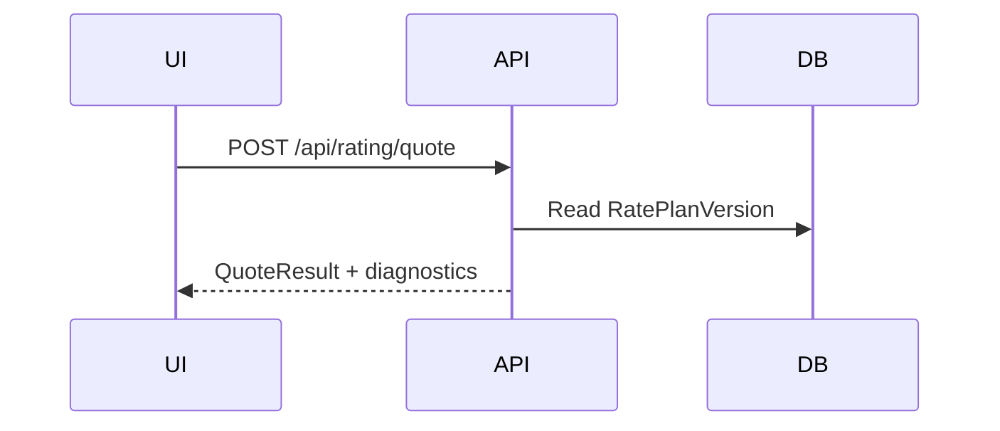

# Data flow

## DLOG ingest

Terminal/modem → transport adapter (future) → ingest API → `DlogTransactions.RawPayload` + classifier JSON + diagnostics.

## Table download

Operator publishes a set and assigns it. On the next bound session the listener sends one frame per item. A table-number acknowledgement completes that item. A missing or negative acknowledgement fails the batch.

## Rating

Quote/authorize uses published rate plan snapshot + host MVP rules — firmware table-rated parity **not asserted**.

